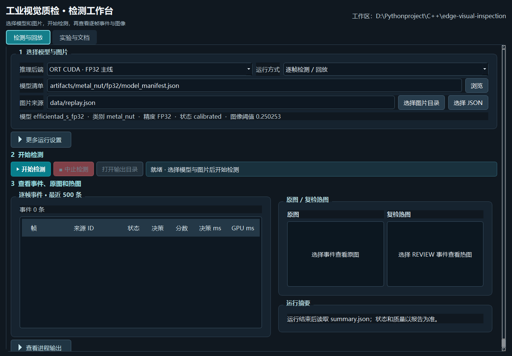
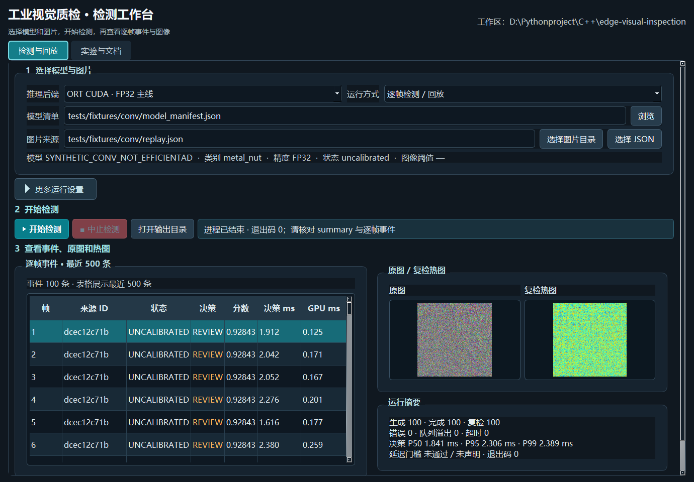
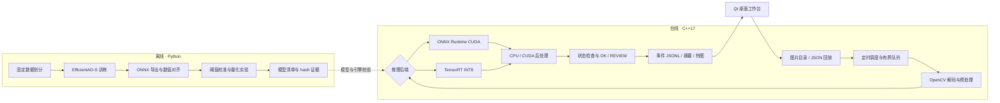

<div align="center">

# Edge Visual Inspection

### 工业零部件缺陷检测 · C++ GPU 边缘推理系统

从 EfficientAD 异常检测，到可追溯的 C++ 推理、CUDA 后处理与桌面工作台。


[快速开始](#快速开始) · [系统架构](#系统架构) · [实测结果](#实测结果) · [文档导航](#文档导航)

</div>

---

面向 **MVTec AD `metal_nut` 单工位场景**的研究原型。Python 负责离线训练、导出和量化分析；C++17 独立完成在线检测，支持 ONNX Runtime CUDA 与直接 TensorRT INT8 推理，并提供可选的 Qt 桌面界面。

项目关注模型进入在线系统后的工程问题：输入输出契约、GPU 实际执行、量化精度审计、排队与超时、逐帧事件记录，以及质量和性能结果的可追溯性。当前整体质量验收为 **`partial`**，具体限制见[独立验收](docs/ACCEPTANCE.md)。

## 界面预览



工作台支持模型与图片选择、检测回放、逐帧事件、原图与复检热图，以及运行摘要。它通过 `QProcess` 启动同一套 C++ 检测程序。

<details>
<summary>查看事件表与热图演示</summary>



该画面来自合成 Conv fixture，仅展示界面与检测程序的连接，不代表真实缺陷检测质量。

</details>

## 核心能力

| 模块 | 实现 |
| :--- | :--- |
| 异常检测 | 基于 Anomalib EfficientAD-S，正常样本训练，输出原始异常图与图像分数 |
| C++ 在线推理 | ONNX Runtime CUDA FP32 主线；直接加载经 hash 校验的 TensorRT INT8 引擎 |
| CUDA 后处理 | 两级 reduction 求异常图最大值，支持非有限值检查和可选阈值掩膜，CPU 实现作为参考 |
| 回放与调度 | 定时到达、有界帧队列、独立事件写者；溢出、超时和异常均可追溯 |
| 决策与产物 | `OK / REVIEW` 决策、逐帧 JSONL、运行摘要、复检热图与原始异常图 |
| 量化审计 | 图等价性、模型与引擎 SHA-256、TensorRT 层精度、实际运行 profile 与质量交叉检查 |
| 桌面工作台 | Qt Widgets 5.15，配置运行参数、启动检测、浏览事件与图像 |

## 系统架构



输入契约为 RGB、`float32`、NCHW、`[1,3,256,256]`，范围 `[0,1]`；输出为 `[1,1,256,256]` 原始异常图。图像分数取异常图最大值，**不是概率**。仅当运行成功、分数有限且低于模型阈值时输出 `OK`，其他情况进入 `REVIEW`。

## 实测结果

以下来自项目既有报告，测试环境为 **RTX 4060 Laptop GPU / Windows x64 / CUDA 12.5 / TensorRT 10.9**。循环回放帧数与独立质量样本数分别统计。

| 项目 | 记录结果 | 适用范围与证据 |
| :--- | :--- | :--- |
| FP32 冻结最终测试 | 79 张，AUROC **0.97604**，FNR **10.94%**，FPR **0%** | [最终质量报告](reports/final_quality.json)；有限数据上的结果 |
| C++ TensorRT INT8 验证 | 69 张，AUROC **0.97759**，FNR **0%**，FPR **5%** | [验证集审计](reports/trt-cpp-validation-quality.json)；派生引擎尚无新的独立最终测试 |
| INT8 实际执行 | **20 个 INT8 卷积** | [执行证据](reports/trt_verified_selective_2.json)；结合详细层精度与运行 profile |
| FP32 连续回放 | 30 分钟，**36,001 / 36,001** 帧，决策 P95 **26.74 ms**，1 次超时 | [事件校验](reports/soak-highres-validation.json)；20 FPS 循环回放 |
| INT8 连续回放 | 30 分钟，**36,001 / 36,001** 帧，决策 P95 **32.51 ms**，5 次超时 | [回放审计](reports/trt-cpp-soak-audit.json)；20 FPS 循环回放 |
| 同后端 C++ pipeline 基准 | FP32 / INT8 wall P50 为 **8.34 / 3.18 ms**，比值 **2.619×** | [基准审计](reports/trt-cpp-benchmark-audit.json)；不含解码、调度和排队；FP32 对照未过冻结阈值质量门槛 |

性能表中的 pipeline 比值不能作为端到端决策延迟提速结论。总体 `quality_pass=partial`：冻结的 percentile 候选未过最终 AUROC 门槛，派生 TensorRT INT8 引擎只有验证集质量证据。项目不包含 PLC 控制、多相机同步、现场联锁或投产验证。

## 快速开始

### 1. 获取源码

```powershell
git clone https://github.com/Nature-Porter/edge-visual-inspection.git
Set-Location edge-visual-inspection
```

仓库包含源码、合成测试 fixture、技术文档和轻量报告。数据集、模型权重、TensorRT 引擎、第三方 SDK、虚拟环境和运行目录需在本地准备；详见[数据说明](data/README.md)和[环境说明](docs/ENVIRONMENT.md)。项目脚本不会自动下载这些资源。

### 2. 准备环境

| 依赖 | 已验证版本 / 放置位置 |
| :--- | :--- |
| 编译工具 | MSVC v143 **14.44**、Windows SDK、CMake **3.31.6**、Ninja |
| GPU 开发环境 | CUDA Toolkit **12.5**；当前 CMake 的 CUDA 架构固定为 `89`，其他 GPU 需相应调整 |
| ONNX Runtime GPU C++ SDK | **1.22.0** → `third_party/onnxruntime-win-x64-gpu-1.22.0/` |
| OpenCV C++ SDK | **4.11.0** → `third_party/opencv/` |
| TensorRT SDK | **10.9.0.34** → `third_party/TensorRT-10.9.0.34/` |
| nlohmann/json | **3.11.3** → `third_party/nlohmann/include/nlohmann/json.hpp` |
| Qt Widgets（可选） | **5.15** MSVC x64 SDK；通过 `-QtRoot` 指定 |

创建 Python 工具环境，安装 fixture、数据准备和报告工具所需依赖：

```powershell
py -3.11 -m venv .venv-tools
.\.venv-tools\Scripts\python.exe -m pip install -r requirements/runtime.txt
```

真实模型训练还需要 Anomalib、PyTorch、torchvision 和 Imagenette。完整依赖模板见 [offline.txt](requirements/offline.txt)，历史实测训练环境见 [train-reuse.txt](requirements/train-reuse.txt)与[环境说明](docs/ENVIRONMENT.md)。其中 `train-reuse.txt` 依赖原机器已有的 CUDA PyTorch 环境，不能直接当作通用安装文件。

C++ 运行还需可发现的 CUDA / cuDNN DLL；若使用不同目录，请按[使用手册](docs/USER_GUIDE.md)检查启动脚本中的 DLL 搜索路径。

### 3. 构建并运行合成示例

在项目根目录的 PowerShell 中执行：

```powershell
# 构建 C++ 程序并运行 CTest
.\scripts\build_windows.ps1

# 生成本机路径的合成 Conv fixture，无需真实数据或训练权重
.\.venv-tools\Scripts\python.exe tools/make_fixture.py

# 每次使用新的运行目录
$run = 'runs/demo-' + (Get-Date -Format 'yyyyMMdd-HHmmss')
.\scripts\run_windows.ps1 run --manifest tests/fixtures/conv/model_manifest.json --source tests/fixtures/conv/replay.json --backend ort-cuda --postprocess cuda --fps 20 --deadline-ms 1000 --output $run

Get-Content "$run/summary.json" -Encoding UTF8
```

合成模型仅验证软件链路，未校准时输出 `REVIEW` 是预期行为，不能用于检测质量或真实模型性能声明。

### 4. 使用真实模型

自行准备 MVTec AD `metal_nut`、EfficientAD teacher 权重与 Imagenette 后，按[完整实验复现](docs/REPRODUCIBILITY.md)依次准备数据、训练、导出、数值对齐、校准和冻结。已有本地 FP32 产物时可直接回放：

```powershell
$run = 'runs/fp32-' + (Get-Date -Format 'yyyyMMdd-HHmmss')
.\scripts\run_windows.ps1 run --manifest artifacts/metal_nut/fp32/model_manifest.json --source data/replay.json --backend ort-cuda --postprocess cuda --fps 20 --output $run
```

TensorRT INT8 路线还需要构建引擎并生成匹配的审计证据；程序会核验模型、引擎和证据 hash。具体命令见[完整实验复现](docs/REPRODUCIBILITY.md)。请在独立工作副本重跑正式训练与最终测试，保留已有冻结记录。

### 5. 打开桌面工作台（可选）

指定本机 Qt 5.15 MSVC SDK 路径；以下路径是示例：

```powershell
.\scripts\build_windows.ps1 -BuildGui -QtRoot 'D:/Qt/5.15.2/msvc2019_64'
```

当前 GUI 启动脚本针对原机器的 **Conda Qt 5.15** DLL 布局编写，原环境可运行：

```powershell
.\scripts\run_gui_windows.ps1 -QtRoot 'D:/anaconda/Library'
```

使用标准 Qt SDK 时，需相应调整启动脚本中的 `Qt5Widgets_conda.dll` 检查，并准备 Qt 平台插件与检测程序的 DLL 搜索路径。详见[工作台指南](docs/GUI_GUIDE.md)。

## 输出与验证

| 产物 | 含义 |
| :--- | :--- |
| `snapshot.json` | 本次运行配置、模型与环境快照 |
| `events.jsonl` | 逐帧来源、运行状态、分数、决策和耗时 |
| `summary.json` | 完成数量、错误与超时、延迟 P50 / P95 / P99 |
| `heat-*.png` / `map-*.tiff` | 复检帧的预览热图 / 原始异常图 |

```powershell
# 无需真实数据的 Python 契约测试
.\.venv-tools\Scripts\python.exe -m pytest -q tests/test_offline.py -k 'not actual_split'

# 校验刚才生成的运行事件
.\.venv-tools\Scripts\python.exe tools/validate_run.py --run $run --output reports/demo-validation.json
```

`scripts/build_windows.ps1` 同时执行 C++ 核心和 CUDA 参考测试。完整 Python 测试还会检查真实数据划分；生成本地数据清单后可移除上述 `-k` 条件运行。更多集成验证命令见[使用手册](docs/USER_GUIDE.md)。

## 项目结构

```text
edge-visual-inspection/
├── src/
│   ├── app/             # C++ CLI、调度、推理与事件流水线
│   ├── backends/        # ONNX Runtime / TensorRT
│   ├── core/            # 模型契约、预处理与基础实现
│   ├── cuda/            # CUDA 异常图后处理
│   └── gui/             # Qt Widgets 工作台
├── include/inspection/  # 公共接口、队列与数据契约
├── tools/               # 离线训练、导出、量化、评测与审计
├── scripts/             # Windows 构建与启动脚本
├── configs/             # 数据、模型、运行与验收配置
├── schemas/             # manifest / event 的 JSON Schema
├── tests/               # C++ / Python 测试与合成 fixture
├── requirements/        # Python 依赖清单
├── reports/             # 轻量结果报告与界面截图
└── docs/                # 使用、设计、实验与验收文档
```

## 文档导航

| 文档 | 内容 |
| :--- | :--- |
| [使用手册](docs/USER_GUIDE.md) | 构建、检测回放、产物阅读与排障 |
| [项目介绍](docs/PROJECT_OVERVIEW.md) | 一帧的路径、模型契约、数据协议与实现入口 |
| [工作台指南](docs/GUI_GUIDE.md) | Qt 界面操作与验证 |
| [完整实验复现](docs/REPRODUCIBILITY.md) | 从训练导出到 TensorRT INT8 审计的命令参考 |
| [独立验收](docs/ACCEPTANCE.md) | 代码、GPU、质量、延迟与稳定性的分别判定 |
| [基准协议](docs/BENCHMARK_PROTOCOL.md) | 计时边界、质量指标与可比条件 |
| [研究报告](docs/REPORT.md) | 模型、量化实验与证据链 |
| [性能分析](docs/PROFILING.md) | Nsight 采样记录与工具限制 |
| [设计决策](docs/DECISIONS.md) / [执行状态](docs/STATUS.md) | 实现选择与阶段记录 |

文档中 `artifacts/`、`runs/`、原始日志及大型 profile 路径指向本地实验产物，这些文件不随源码分发；仓库保留轻量汇总报告。历史实测值不代表克隆仓库后已经重新完成了相同实验。

## 数据与第三方来源

异常检测模型采用 [Anomalib](https://github.com/open-edge-platform/anomalib) 的 EfficientAD 实现；数据来自 [MVTec AD](https://www.mvtec.com/research-teaching/datasets/mvtec-ad/downloads)。数据集、预训练权重及第三方 SDK 遵循各自许可，使用前请查阅对应来源。项目的数据来源、哈希与划分说明见 [data/README.md](data/README.md)。
