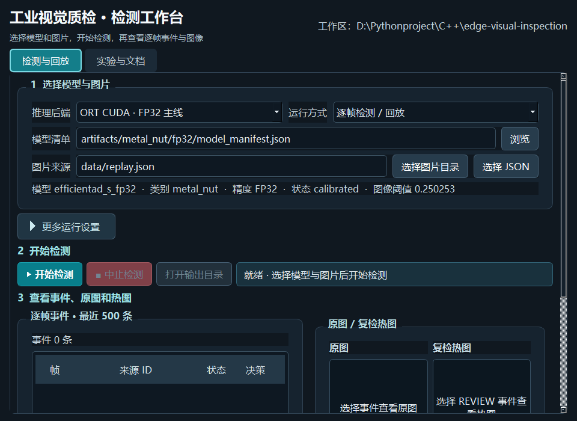

# Qt 检测工作台使用说明

这是可选的 **C++/Qt Widgets 5.15** 桌面前端。它调用同一构建目录下的 `inspection.exe` 完成检测，界面负责配置、启动、展示事件和热图；GPU 推理、后处理、决策与事件写入仍在原 C++ 检测程序中。界面不改变已冻结的模型、阈值或验收结果。

## 当前机器：无需再安装 Qt

本机已检测到 `D:/anaconda/Library` 中的 Qt 5.15.2 MSVC SDK、Qt Widgets 头文件/库和 `qwindows.dll` 插件。它和本项目的 MSVC x64 构建配合使用；仅当前进程设置运行路径，不复制或替换 Anaconda 安装。用户仍负责所有下载，本功能没有触发下载。换机器时如果缺少 Qt，请自行安装 **MSVC x64 版 Qt 5.15 Widgets 开发组件**，并以 `-QtRoot` 指向包含 `lib/cmake/Qt5Widgets/Qt5WidgetsConfig.cmake`、`bin`、`plugins/platforms` 的 Qt 前缀目录。该目录结构比 `qmake` 是否在 PATH 中更重要。

## 在 VS Code 中构建与打开

在项目根目录 PowerShell 终端执行：

```powershell
.\scripts\build_windows.ps1 -BuildGui -QtRoot D:/anaconda/Library
.\scripts\run_gui_windows.ps1 -QtRoot D:/anaconda/Library
```

构建脚本自动加载 MSVC x64 开发者环境、运行 CMake/CUDA 构建与 CTest；GUI 可执行文件为 `build/inspection_gui.exe`。启动脚本为 GUI 及其子进程提供 Qt/OpenCV/TensorRT/CUDA 的本地 DLL 搜索路径。常规 `scripts/build_windows.ps1` 不构建可选界面；不会影响原有无界面检测程序。


窗口缩小到 960×700 时，检测页仍可通过滚动查看完整结果：



合成 Conv fixture 的运行画面用于检查事件表与图像预览，不代表真实模型质量：


## 检测与回放页

1. **选推理后端**：`ORT CUDA · FP32 主线` 或 `TensorRT INT8 · 验证路线` 会自动带入已存在的 manifest。`ORT CPU` 只供故障诊断；`TensorRT FP32` 仅是性能对照，它在冻结阈值下没有通过原设质量门槛。自定义 manifest 可通过“浏览”替换。
2. **选图片来源**：可选择当前目录直接包含 `.png/.jpg/.bmp` 的图片文件夹，或现有 `data/replay.json` 这类 JSON 清单；目录模式不递归。选择一张图片时可放在单独文件夹中使用目录模式。自有图片可用于试运行，但不会自动取得正式测试集标注。
3. **按需展开“更多运行设置”**：输出目录留空时自动生成 `runs/gui-时间戳`；如果选定目录已有 `events.jsonl`，界面拒绝覆盖。FPS、截止期、帧队列容量、预热次数、是否循环及有限时长、CPU/CUDA 后处理仍映射到已有 C++ CLI。循环回放仅用于稳定性，不增加质量样本。
4. **开始检测**：按按钮或 `Ctrl+Enter`。下方表格实时读取 `events.jsonl`，只保留最近 500 行；总事件计数仍累计。用鼠标或方向键选中事件，可并排查看来源原图和复检热图 `heat-<frame_id>.png`；窗口缩放时图片会随预览区调整。具体原始异常图保存在对应 `map-<frame_id>.tiff`。运行结束后摘要读取 `summary.json`。

按 `Tab` 和 `Shift+Tab` 可依次访问输入、浏览按钮、更多设置、检测按钮、事件表格及日志开关；当前焦点有亮色边框。事件表格用方向键切换行，`Tab` 可离开表格。要排查子进程输出时，展开“查看进程输出”。

切换到“基准测试”可选 `pipeline`、`model` 或 `replay` 模式与迭代次数。`pipeline` 不含解码/调度/队列，`model` 还不含预处理；只有回放路径的 `decision_latency_ms` 从计划到达时刻计时。不要把基准 P50 当作端到端决策 P95。

“中止运行”会终止检测进程，可能得不到完整 `summary.json`；该次运行不能用于正式验收。界面只显示报告结果，不会因为程序退出码 0 就声称质量或 GPU INT8 已通过。在线精度证据仍以 `reports/` 中的层精度与 profile 审计为准。

## 实验与文档页

可快速打开使用手册、项目介绍、完整实验复现、P0–P8 状态、独立验收、最终质量 JSON 和 TensorRT 证据。离线训练、导出、验证、量化的命令可以复制到 PowerShell；**界面不会自动运行这些命令**，因为现有 `metal_nut` 已有冻结测试和训练产物，在同目录重跑可能覆盖证据。若要重新训练，应先按 [使用手册](USER_GUIDE.md)在独立工作副本准备数据与产物。

## 验证与排障

```powershell
# 启动 Qt、构造界面，并写入 reports/gui-preview.png
.\scripts\run_gui_windows.ps1 -GuiArgs '--smoke-test'

# 另存一张 960×700 窗口截图到 reports/gui-preview-compact.png
.\scripts\run_gui_windows.ps1 -GuiArgs '--smoke-test-compact'

# GUI 驱动合成 Conv fixture 运行；只测界面到 C++ 子进程的连接，不代表真实模型质量
$env:QT_QPA_PLATFORM = 'offscreen'
.\scripts\run_gui_windows.ps1 -GuiArgs '--smoke-run'
Remove-Item Env:QT_QPA_PLATFORM

# 在 Windows 桌面运行同一合成 fixture，并截取事件、原图和热图
.\scripts\run_gui_windows.ps1 -GuiArgs '--smoke-run-preview'
```

`--smoke-run` 在 `runs/gui-smoke-*` 生成真实 `snapshot/events/summary`，可用 `tools/validate_run.py` 校验。若正常启动失败，先检查 `build/inspection_gui.exe`、`D:/anaconda/Library/bin/Qt5Widgets_conda.dll` 和 `D:/anaconda/Library/plugins/platforms/qwindows.dll`；若界面能打开但检测子进程失败，查看界面“进程输出”、该次输出目录与 [环境说明](ENVIRONMENT.md)。GPU 执行、质量和延迟结论仍以 [独立验收](ACCEPTANCE.md) 为准。
