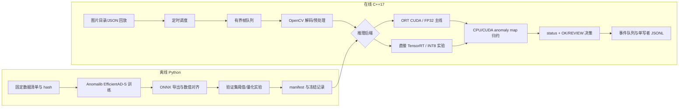

# 项目介绍：工业零部件缺陷检测 C++ 边缘推理研究原型

## 项目定位

本项目在 MVTec AD `metal_nut` 单工位数据上研究“正常样本训练的异常检测模型如何进入可审计的 C++ GPU 检测链路”。离线阶段用 Python/Anomalib 训练 EfficientAD-S、导出 ONNX、校准阈值与比较精度；在线阶段由 C++17 程序独立完成读图、回放调度、GPU 推理、CUDA/CPU 后处理、决策与事件记录。它是可运行的研究原型，不包含 PLC 控制、多相机同步、工厂现场安全联锁或商业部署声明。

项目要解决的工程难点不只是“模型能跑”：还要证明输入输出语义一致、GPU 算子真的执行、量化层真的使用 INT8、错误有可追踪终态，以及质量、延迟、稳定性分别通过什么验收。

## 系统结构与一帧的路径

程序启动时先读取 manifest 并校验模型 hash、形状、阈值来源；TensorRT 路线进一步校验 engine/evidence/model hash。每张图在计划到达时刻获得 `frame_id`，通过容量可配置的帧队列交给单工作线程。队列满时产生 `QUEUE_OVERFLOW` 事件并转人工复检，不静默丢帧。工作线程解码图片、做预处理、调用后端、归约 anomaly map，并依据模型分数及运行状态作出决策。事件交给单独写者线程保存；复检帧保存原始 TIFF 异常图和 PNG 热图。每个已生成帧最终应对应一条事件。

核心实现入口：[在线主程序](../src/app/main.cpp)、[契约与队列](../include/inspection/contracts.hpp)、[预处理/清单实现](../src/core/contracts.cpp)、[ORT 后端](../src/backends/ort_backend.cpp)、[TensorRT 后端](../src/backends/trt_backend.cpp)、[CUDA 后处理](../src/cuda/postprocess.cu)。

## 模型与张量契约

EfficientAD-S 来自 Anomalib 2.1.0。本仓库的 [模型适配层](../tools/model.py)负责把项目的固定数据清单、训练/正常统计路径以及导出接口接到官方模型；没有自写 EfficientAD 损失函数或网络训练算法。正式训练为 10000 步，checkpoint、训练日志和版本见 `artifacts/metal_nut/training/training.json`、`reports/train-full.log` 与 [环境记录](ENVIRONMENT.md)。

输入是 `float32`、RGB、NCHW、`[1,3,256,256]`，范围 `[0,1]`。C++ 用 OpenCV `INTER_LINEAR` 缩放，BGR→RGB，除以 255 一次；模型内部负责其图内归一化。输出是 `float32` 原始异常图 `[1,1,256,256]`。图像分数是 `max(raw_anomaly_map)`，按 manifest 的 `image_threshold` 决策；这不是经概率校准的置信度。FP32 manifest 当前阈值约 `0.250253`，派生 TensorRT INT8 manifest 阈值约 `0.456021`，阈值不能跨模型互用。`pixel_threshold=null`，因此没有像素级 IoU/定位通过声明。

[导出脚本](../tools/export_onnx.py)保留完整 ONNX 并生成在线使用的核心 ONNX，运行 ONNX checker 和数值对齐。[图审计](../artifacts/metal_nut/fp32/graph_audit.json)与 [69 张验证图对齐记录](../reports/alignment.json)用于防止“外部已经标准化，图内又标准化一次”等契约错误。正式对齐中 PyTorch/ORT 同张量最大绝对差约 `2.38e-6`，C++ 全链路分数最大绝对差约 `1.79e-7`；这是数值对齐，不等于检测质量通过。

## 数据协议与质量评价

真实数据是 MVTec AD `metal_nut`。固定数据清单及其 SHA-256 在 [数据协议记录](../reports/data_protocol.json)：训练正常 154、正常统计 33、开发正常 33、量化校准 128、验证 69、最终测试 79。数据准备按固定 seed 分割，按图像身份审计覆盖与重复；回放循环只重复既有图像，不增加独立样本数。资源许可及本地目录见 [数据说明](../data/README.md)。

训练、正常统计、开发/校准、验证和最终测试各司其职。验证集允许校准图像阈值、筛量化方案；`artifacts/frozen.json` 记录最终测试前的候选 manifest、配置和 test hash。最终测试只评估冻结候选，不能再用测试结果改阈值或挑层。`tools/evaluate.py` 的 test 模式会拒绝与冻结 hash 不匹配的输入。质量审计按原始 `source_image_id` 联合预测与标签，检查覆盖和唯一性；指标定义在 [metrics.py](../tools/metrics.py)。

正常样本误报率 `FPR = FP/(FP+TN)`，缺陷漏检率 `FNR = FN/(TP+FN)`；AUROC 衡量分数的排序能力，和某个阈值下的 FNR/FPR不是一回事。FP32 冻结测试为 79 张：TP=57、FN=7、TN=15、FP=0、AUROC≈0.97604、FNR=0.109375、FPR=0。样本量有限，不能据此宣传“零漏检”。完整候选对比见 [最终质量报告](../reports/final_quality.json)；`int8_percentile` 最终 AUROC 相对下降约 0.02083，超过预设 0.01 门槛。因此 [独立验收](ACCEPTANCE.md) 的 `quality_pass` 是 **partial**。

## 推理与量化路线

FP32 主线使用 C++ ONNX Runtime CUDA EP。后端禁用 CPU EP 回退，使用 CUDA stream、设备 I/O Binding 与同步后的 CUDA Events；[正式 profile 证据](../reports/fp32-provider-evidence.json)显示记录的 3000 个节点事件均由 CUDA EP 执行。若改用 `ort-cpu`，应明确标成 CPU 诊断，不能延用 GPU 结论。

离线量化包括 FP16、MinMax/Percentile 静态 S8S8 QDQ、逐通道权重量化，以及按激活差异排除敏感卷积层的混合 INT8/FP32 候选。QDQ 图中有量化节点，只能证明**图的意图**；ORT CUDA 严格模式下原始 QDQ 路线存在 CPU `DequantizeLinear` 回退，不能因为 provider 名称或文件名就声称“全 GPU INT8”。相关诊断及候选在 [量化报告](../reports/quantization.json) 和 [决策记录](DECISIONS.md)。

可实际验证的 INT8 路线是在冻结的 `int8_selective_2` 的**派生副本**上，将 20 个常量 bias 的 `DequantizeLinear` 折叠为等价 FP32 常量，再构建 TensorRT 10.9 详细引擎。副本和源图在 69 张 validation 的 ORT 输出等价；详细层精度、`i8i8` tactic 与运行 profile 对应，证明该引擎实际执行 20 个 INT8 卷积。C++ 程序直接加载此引擎，不借助 Python 代跑。证据链见 [TensorRT 总证据](../reports/trt_verified_selective_2.json)、[C++ 验证集审计](../reports/trt-cpp-validation-quality.json)。验证集 69/69 有效，TP=29、FN=0、TN=38、FP=2、AUROC≈0.97759；C++ 与直接 TensorRT 分数最大差约 `3.34e-6`。**该派生引擎没有新的独立最终测试质量声明**，不能继承源 QDQ 模型在既有 test 上的结论。

## CUDA、实时性与故障处理

[CUDA 后处理](../src/cuda/postprocess.cu)以两级 reduction 求 anomaly map 最大值，并处理非有限值与可选阈值掩膜。CPU 版本提供数值参考；长度、NaN/Inf、掩膜等测试和正式验证图对照证明正确性。后处理局部中位时间曾测得 CPU `0.2446 ms`、CUDA `0.05069 ms`，但整管线收益会受模型耗时、传输、温度影响，不能固定外推。

决策规则很保守：仅当 `status=SUCCESS`、分数有限、阈值存在且 `score<threshold` 才是 `OK`，其他全部 `REVIEW`。`status` 与 `decision` 分离，因此高分异常图也可为 `SUCCESS+REVIEW`，超时帧也可保留分数但必须复检。预设 20 FPS、50 ms 截止期、帧队列容量 4；`decision_latency_ms` 从**计划到达时刻**计时，包含等待队列及后续处理，保存热图发生在决策之后并单列时间。运行错误、无效图片、队列溢出和写盘失败都有可追踪结果或基础设施退出码。

正式 FP32 ORT CUDA 30 分钟回放完成 `36001/36001` 帧，决策 P95≈`26.7411 ms`，1 次超时；见 [回放汇总](../runs/soak-highres/summary.json) 与 [事件审计](../reports/soak-highres-validation.json)。C++ TensorRT INT8 30 分钟回放也完成 `36001/36001` 帧，P95≈`32.5113 ms`、5 次超时；见 [INT8 回放审计](../reports/trt-cpp-soak-audit.json)。这些是同一验证/回放清单循环的稳定性证据，绝非 36001 张独立质量样本。WDDM 下进程级 VRAM 未取得，已有工作集采样不能替代显存证明。

同一 C++ TensorRT 后端、相同输入的三轮 pipeline benchmark 中，FP32/INT8 wall P50 分别约 `8.3386/3.1841 ms`，比值 `2.619×`。该模式不含解码、排队和调度；其 FP32 TensorRT 对照在冻结阈值上的验证 FNR 门槛未通过，所以不能宣称“两条合格部署路线的端到端决策提速 2.619×”。见 [速度审计](../reports/trt-cpp-benchmark-audit.json)。

## 当前交付与可扩展方向

[STATUS](STATUS.md)中的 P0–P8 实现与阶段检查均有记录；[ACCEPTANCE](ACCEPTANCE.md)将代码完成、GPU 验证、质量、延迟、稳定性、INT8 执行和速度声明分别列出。最主要的未闭合点是整体 `quality_pass=partial`：一个冻结候选未过最终 AUROC 门槛，派生 TensorRT INT8 引擎尚无新的独立最终质量测试。若今后给派生引擎追加这种声明，需要一批此前未用于开发、选型或既有最终测试的真实新图，单独冻结方案后评价；这不是复现当前功能的前置条件。

合理的后续研究包括更大规模跨批次数据、独立的派生引擎最终测试、可比的合格 FP32/INT8 决策延迟 A/B，以及 WDDM 之外可核查的进程显存采样。这些均不能写成当前已经达成的结果。
